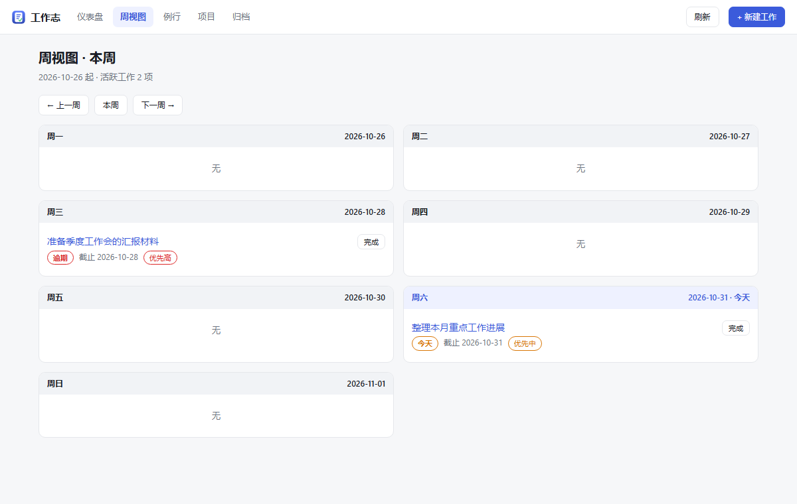

# dsh-worklog

在 DSH 里直接可用的「工作志」——个人工作跟踪面板。

插件自带全部功能：数据存在你本机的一个 SQLite 文件里，不依赖任何外部服务，也不需要另外安装数据库。


## 功能

| 视图 | 说明 |
|---|---|
| 仪表盘 | 逾期 / 今日到期 / 临期 / 本周 / 无截止日期 五个分桶 |
| 周视图 | 一周七天各列一处，按截止日期落位，今天高亮 |
| 工作详情 | 标题、详情、完成条件、优先级、项目、标签；可追加进展记录 |
| 例行 | 每周/每月模板，按周期自动生成本期任务，同一周期不重复生成 |
| 项目 | 把工作归到项目下 |
| 归档 | 已完成的全部留存 |



## Agent 工具

插件向 agent 注册 5 个工具，AI 可以读写同一份数据：

| 工具 | 用途 |
|---|---|
| `worklog_list` | 按周、状态、关键词列出工作项 |
| `worklog_add` | 新建一条工作 |
| `worklog_done` | 标记完成 |
| `worklog_progress` | 追加进展记录 |
| `worklog_summary` | 概览各分桶数量 |

## 数据存放

```
~/.dsh/worklog/worklog.db
```

一个 SQLite 文件（WAL 模式）。备份就是复制这个文件。尊重 `DSH_HOME`，多份 profile 互不干扰。

## 安装

```bash
dsh plugin --profile <profile> add dsh-worklog
```

或在本仓库目录下：

```bash
dsh plugin --profile <profile> add link:.
```

安装后在侧边栏出现「工作志」一行。

## 开发

```bash
# 把插件的页面挂到一个临时 HTTP 服务上，用于浏览器调试
node test/dev-server.mjs     # http://127.0.0.1:8091/worklog-plugin/app

# 端到端验证（假宿主 + 真 SQLite）
node test/integration.mjs

# 验收：干净环境下不需要任何外部服务
node test/acceptance.mjs
```

## 组成

| 文件 | 作用 |
|---|---|
| `lib/store.js` | SQLite 建库与设置读写（`node:sqlite`，无原生依赖） |
| `lib/service.js` | 业务规则：周归属、完成归档、分桶、例行去重 |
| `lib/views.js` | 服务端渲染的页面与样式（含深色模式） |
| `lib/index.js` | 路由挂载与 agent 工具注册 |
| `lib/client.js` | 浏览器侧：侧边栏行 + 主视图 |
| `cordis.patch.yml` | 把插件行插进 profile 的插件表 |

## 设计取舍

**界面是服务端渲染 + 同源 iframe，而不是纯 React 树**：整个插件几个文件、没有构建步骤、没有打包产物。面板嵌入的是插件自己的路由，不存在跨域或第三方依赖。

**用 `node:sqlite`**：Node 自带，不需要编译原生模块，用户也不需要另装数据库。

## 已知限制

- 单用户：DSH 本身是个人环境，没有多用户与登录
- 没有 Word 导出：docx 排版需要额外依赖，未实现
- 没有 Obsidian 集成与外部推送：本质上依赖外部系统
- 报告不调用外部模型：由 DSH 的 agent 通过上面的工具完成

## License

MIT
